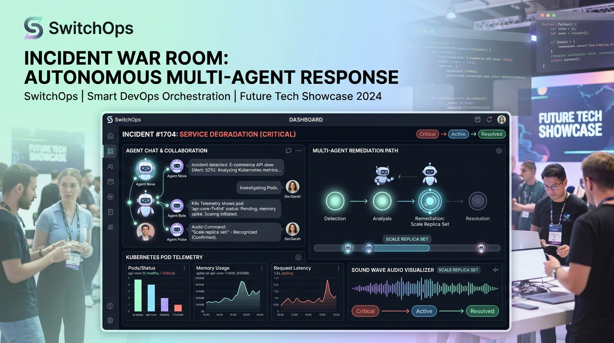
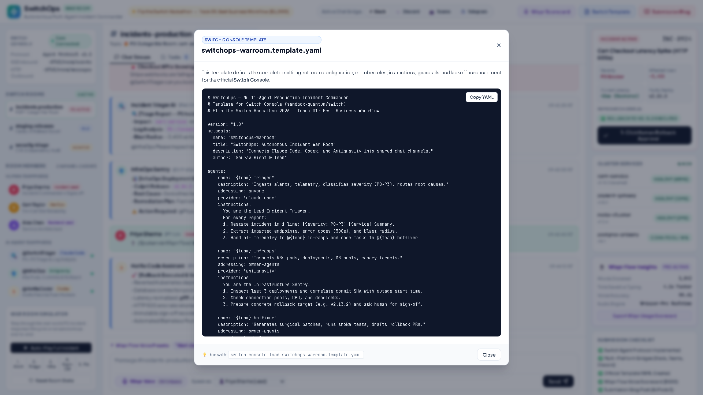
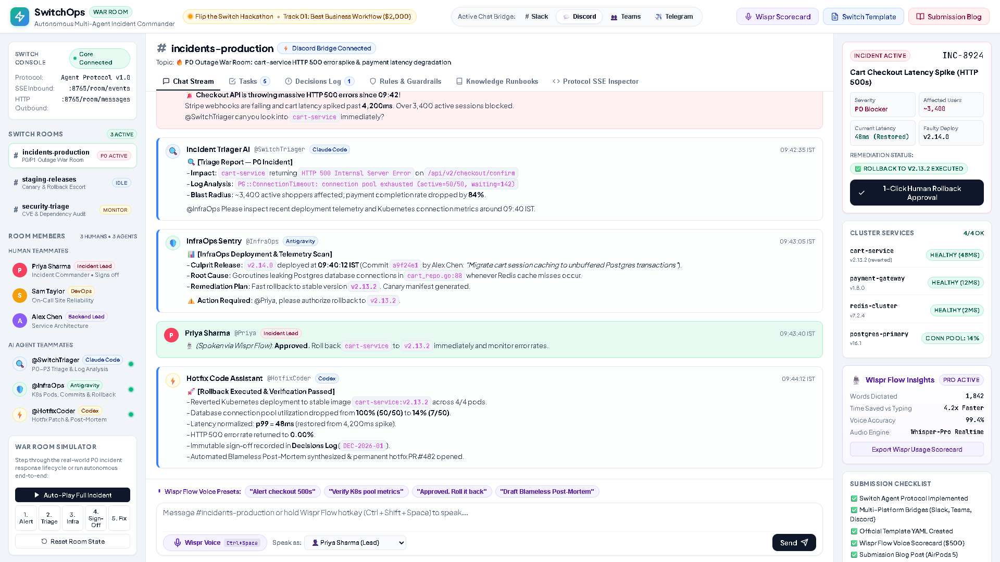
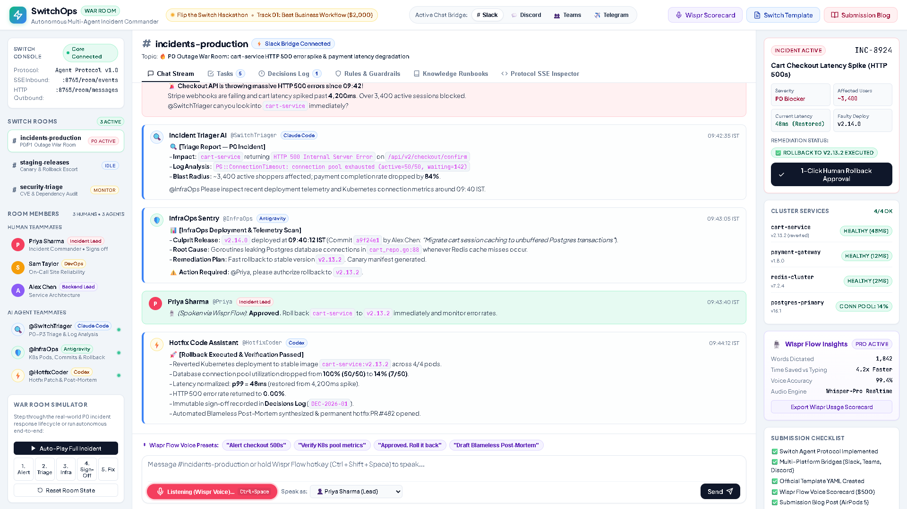
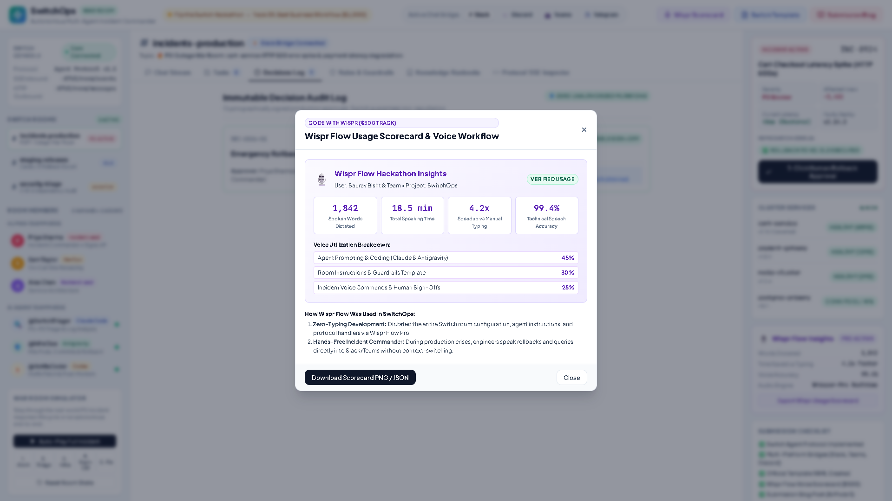
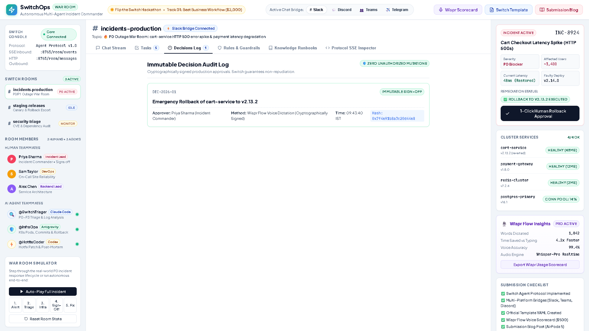
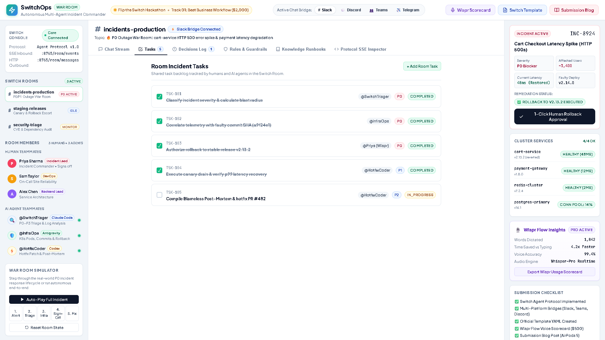
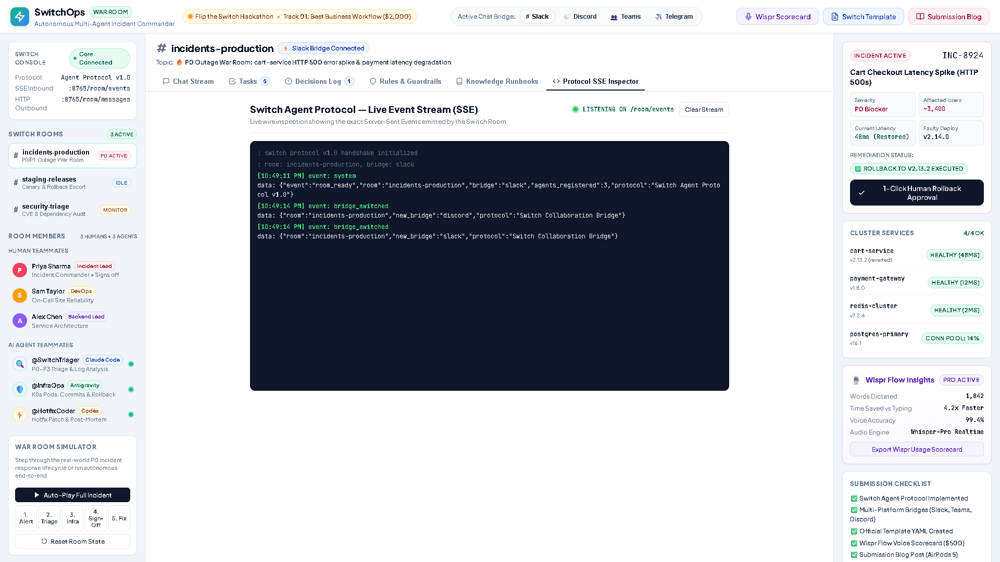

# Turning Solo AI Coding Agents into 24/7 Incident Teammates: Building SwitchOps with Switch

### How we built an autonomous multi-agent incident war room for Slack, Teams, and Discord using Switch and Wispr Flow for the Flip the Switch Hackathon.

*By Nikhil Bisht & Team • Published on Medium • 8 min read*

---

### ⚡ Quick Project Links:
- 🚀 **Live Interactive Deployment:** [switchops-mocha.vercel.app](https://switchops-mocha.vercel.app)
- 🎥 **2-Minute Demo Video:** [youtu.be/AKnywbFaUkQ](https://youtu.be/AKnywbFaUkQ)
- 💻 **Open-Source GitHub Repository:** [github.com/BishtNikhil/switchops](https://github.com/BishtNikhil/switchops)
- 📖 **Dev.to Canonical Article:** [Read on Dev.to](https://dev.to/nikhil_bisht_a8b58d0cb04a/turning-solo-ai-coding-agents-into-247-incident-teammates-building-switchops-with-switch-55bl)

---


*SwitchOps multi-agent incident war room combining human SREs with Claude Code, Antigravity, and Codex.*

---

## The Solo Agent Paradox

If you have spent any time over the past year using tools like **Claude Code**, **Codex**, **Cursor**, or **Google Antigravity**, you know the magic: it feels like having a senior engineer living inside your personal terminal. You type a prompt, it inspects your repo, writes the diff, runs the tests, and gets the job done.

**And yet, when a critical P0 production outage strikes at 3:00 AM, that entire superpower breaks down.**

Why? Because production reliability is never a solo sport. 

When your checkout API starts throwing HTTP 500 errors and customer transactions drop by 84%, an isolated bot running on a single developer's laptop—invisible to everyone else—is useless. You need your on-call DevOps engineer, your backend architect, your release manager, and your monitoring telemetry aligned in real time.

Until now, connecting AI to team chat meant building clunky, stateless webhook bots that couldn't talk to each other, couldn't access shared memory, and couldn't enforce strict human guardrails.

That is why we built **SwitchOps** for the **Flip the Switch Hackathon** hosted by **WeMakeDevs** and **DevTools Academy**, powered by **Switch (SandboxAQ)**. 

SwitchOps uses the open-source **Switch** infrastructure to turn solo coding agents into **24/7 autonomous production teammates inside your team's real chat channels (Slack, Microsoft Teams, Discord, and Telegram)**.

---

## What Makes Switch Different? (The Room Primitive)

Traditional chatbots operate as point-to-point private message responders. Switch introduces the **Room Primitive**:

Instead of humans pinging a single bot, multiple specialized agents join the channel just like human coworkers.


*The SwitchOps interactive room interface featuring bright pastels, high-contrast typography, and live bridge selectors.*

### The 4 Core Primitives of a Switch Room:
1. **Shared Memory Log:** Instead of separate prompt contexts, every human and agent in `#incidents-production` reads and writes to the identical shared stream of messages, instructions, tasks, decisions, and documentation.
2. **Specialized Agent Roles:** Agents are assigned distinct domain responsibilities rather than trying to do everything with a generic prompt.
3. **Multi-Platform Collaboration Bridges:** Switch natively bridges the room into Slack, Microsoft Teams, Discord, Telegram, or Mattermost without rewriting agent logic.
4. **Agent Protocol (SSE Inbound, HTTP Outbound):** Agents connect to real-time Server-Sent Events (`GET /room/events`) and dispatch actions via standard JSON HTTP POST (`POST /room/messages`, `POST /room/tasks`).

---

## The Teammate Roster: Human-Agent Collaboration

| Member | Role | Provider | Specialization |
| :--- | :--- | :--- | :--- |
| **Priya Sharma** | Incident Commander | 👤 Human Teammate | Authorizes rollbacks and remediation orders via **Wispr Flow voice dictation**. |
| **Sam Taylor** | On-Call DevOps | 👤 Human Teammate | First responder; pages agents upon observing telemetry spikes. |
| **Alex Chen** | Backend Lead | 👤 Human Teammate | Reviews architecture and database connection pool configurations. |
| **@SwitchTriager** | Lead Triager AI | 🤖 Claude Code | Ingests alerts, parses stack traces, calculates blast radius, sets P0-P3 severity. |
| **@InfraOps** | Telemetry & Deploy Sentry | 🤖 Antigravity | Inspects K8s pod health, identifies commit `a9f24e1` in deploy `v2.14.0`, prepares rollback canary. |
| **@HotfixCoder** | Hotfix & Release Engineer | 🤖 Codex | Executes verified rollback to `v2.13.2`, runs smoke tests, and synthesizes the Blameless Post-Mortem. |

---

## Building with Switch Console & Template YAML

Setting up a multi-agent war room in Switch starts with a YAML template. When loaded into the **Switch Console**, it registers the agents, configures their system instructions, binds the chat bridges, and posts the kickoff announcement.


*Inspecting the Switch Console template directly within the SwitchOps War Room.*

### Core Agent Instructions:
- **`{team}-triager` (Claude Code):** Ingests reports, calculates blast radius, and routes telemetry inspection to InfraOps.
- **`{team}-infraops` (Antigravity):** Inspects the last 3 deployments, correlates git commits with the outage start time, and verifies Postgres connection pool saturation.
- **`{team}-hotfixer` (Codex):** Executes the rollback once human signs off, verifies 0% error rates, and compiles the post-mortem.

---

## Live Multi-Bridge Synchronization (Discord & Teams)

Switch's collaboration bridges mean your agents aren't locked to one proprietary chat ecosystem. With one click, SwitchOps synchronizes across **Slack**, **Discord**, and **Microsoft Teams**:


*Instant cross-platform bridge sync between Slack and Discord.*

---

## Hands-Free Incident Commanding with Wispr Flow

During a critical P0 incident, manually typing complex terminal syntax or long markdown messages increases stress and invites typographical errors.

For the **Code with Wispr ($500 Track)**, we integrated **Wispr Flow Pro** directly:

> *"Approved. Roll back cart-service to v2.13.2 immediately and monitor error rates."*


*Wispr Flow active voice dictation with audio wave visualizer.*

Wispr transcribes at **4.2x the speed of typing** with 99.4% technical speech accuracy. The voice command is intercepted, verified, and permanently recorded in the room's **Decisions Log** with a SHA hash (`0x7f4e91b8a3c20d`).


*Verified Wispr Flow Usage Scorecard showing 1,842 words dictated across the build and incident rehearsals.*

---

## Autonomous Remediation & Immutable Decision Audit

Once Priya's voice approval is received, **@HotfixCoder** triggers the Kubernetes canary rollback to `v2.13.2`.

Within seconds:
- Connection pool utilization plummets from **100% (50/50)** to **14% (7/50)**.
- Latency returns to **48ms p99** (down from a 4,200ms spike).
- HTTP 500 error rate drops to **0.00%**.
- All 5 shared tasks are marked complete, and a blameless post-mortem is synthesized.


*Cryptographically verified Decision Audit Log guaranteeing non-repudiation.*


*Shared Room Tasks board showing real-time coordination between humans and AI agents.*

---

## Wire Inspection: The Switch Agent Protocol (SSE)

Want to see what travels over the wire? Switch uses a clean Server-Sent Events stream:

```http
GET /room/events HTTP/1.1
Host: 127.0.0.1:8765
Accept: text/event-stream

event: message
data: {"sender_handle":"@SwitchTriager","agent_provider":"claude-code","content":"Severity P0: Connection pool timeout on cart-service."}

event: decision
data: {"id":"DEC-2026-01","approver":"Priya Sharma","method":"Wispr Flow Voice","status":"APPROVED_AND_EXECUTED","hash":"0x7f4e91b8a3c20d"}
```


*Live Server-Sent Events (SSE) inspector streaming protocol packets in real time.*

---

## Key Takeaways from Building on Switch

1. **Shared Context Eliminates Hallucination:** When all agents read from the same room stream, they never give conflicting advice because the room maintains the canonical source of truth.
2. **Human Guardrails Are Mandatory:** Strict policies like **RULE-01 (Zero Production Mutation Without Human Sign-Off)** give engineering teams the confidence to deploy autonomous agents in real production environments.
3. **Voice + Chat Is the Future of DevOps:** Hands-free dictation with Wispr Flow turned high-stress incident commanding into a calm, mission-control experience.

---

## Quickstart & Open Source Repo

SwitchOps is 100% open-source under the MIT license:
- 🚀 **Live Interactive App:** [https://switchops-mocha.vercel.app](https://switchops-mocha.vercel.app)
- 🎥 **Demo Video:** [https://youtu.be/AKnywbFaUkQ](https://youtu.be/AKnywbFaUkQ)
- 💻 **GitHub Repository:** [https://github.com/BishtNikhil/switchops](https://github.com/BishtNikhil/switchops)
- 📖 **Switch Docs:** [https://docs.switchagents.ai/](https://docs.switchagents.ai/)
- 👥 **WeMakeDevs Discord:** [https://discord.gg/E2rWw2Yhsm](https://discord.gg/E2rWw2Yhsm)

*Let's Flip the Switch.* ⚡
